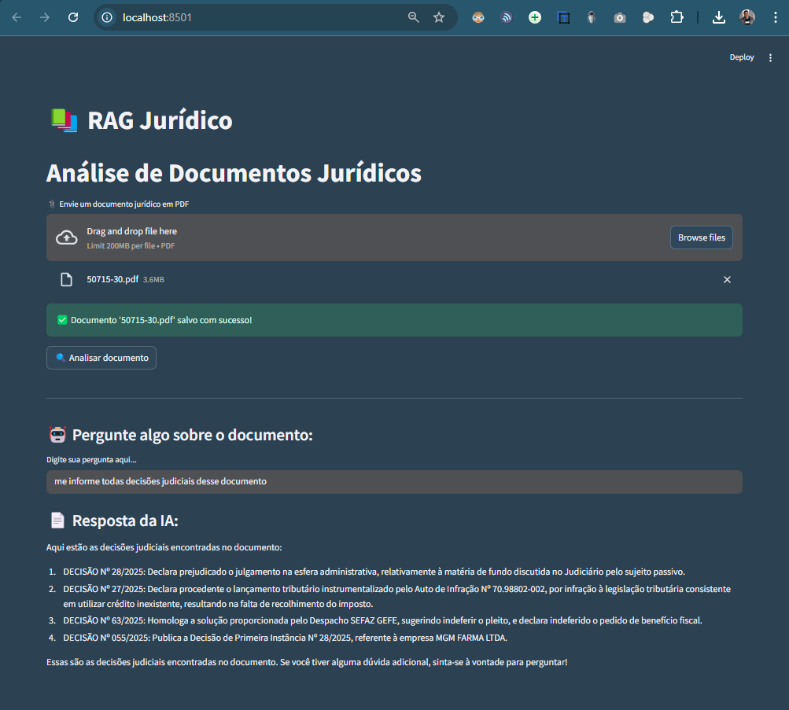

# 🧠 Legal RAG System

A Retrieval-Augmented Generation (RAG) system designed for legal document analysis using Large Language Models (LLMs). The system allows users to upload legal documents (PDFs), generate embeddings, index data with FAISS, and ask questions in natural language with answers grounded in the source content.

---

## 🚀 Objective

Demonstrate how RAG can be applied in the legal domain to improve the extraction and analysis of information from legal documents such as contracts, petitions, court decisions, and legal opinions.

---

## Demo
- https://www.linkedin.com/feed/update/urn:li:activity:7326319147112402945/

---

## 🖼️ System Preview

Below is a preview of the application layout in execution:



---

## 🔧 Technologies Used

- Python 3.10+
- Streamlit
- LangChain
- FAISS
- Sentence-Transformers
- Llama API (via Groq)
- Docling
- Pytest (testes automatizados)

---

## 📁 Project Structure

```
rag_juridico/
│
├── app.py                 # Streamlit interface
├── rag_pipeline.py        # Ingestion, embedding, indexing, and QA pipeline
├── utils.py               # Helper functions (loading, token counting, etc.)
├── requirements.txt       # Project dependencies
├── pytest.ini             # Test configuration
├── LICENSE                # Project license
├── README.md              # Documentation
│
├── assets/
│   └── layout_sistema.png
│
├── .streamlit/
│   ├── secrets.toml       # Secure deployment config
│   └── config.toml
│
├── data/
│   ├── documentos/        # Input PDF documents
│   └── indexes/           # Generated FAISS indexes
│
├── tests/
│   ├── test_pipeline.py   # Pipeline unit tests
│   └── test_utils.py      # Utility function tests
```

---

## ▶️ How to Run

1. Create and activate a virtual environment:
```bash
python -m venv venv
source venv/bin/activate  # ou venv\Scripts\activate no Windows
```

2. Install dependencies:
```bash
pip install -r requirements.txt
```

3. Run the application:
```bash
streamlit run app.py
```

---

## 🧪 Automated Tests

This project uses pytest for unit testing. Tests are located in the tests/ folder and cover:

- Utility functions (`utils.py`)
- RAG pipeline components (`rag_pipeline.py`)

### ✔️ Run tests

```bash
pytest tests/
```

### 🧹 Cleanup

Temporary files such as FAISS indexes generated during testing are automatically removed after execution.

---

## 🛠️ Funcionalidades

- [x] Upload legal documents (PDFs)
- [x] Text extraction and chunking
- [x] Embedding generation
- [x] FAISS vector indexing
- [x] LLM-based question answering grounded in documents
- [x] Automated tests with pytest
- [ ] API data ingestion
- [ ] Query history tracking
- [ ] Automated report generation

---

## 📌 Technical Notes

This project implements a traditional RAG architecture, following a linear pipeline for ingestion, vector indexing, and retrieval using FAISS, combined with an LLM (Groq + LLaMA 3) to generate context-aware responses based on legal documents.

The current architecture is suitable for:
- 🟢 **Lightweight production environments**
- 🧪 **Institutional demonstrations**
- 📄 **Direct PDF document analysis use cases**

### 🧠 Future Evolution: LangGraph-based RAG

For more advanced scenarios such as:
- Multi-step reasoning workflows (e.g., summarization + verification + response)
- Stateful conversational memory
- Conditional LLM workflows and agents

The system can be evolved into a LangGraph-based architecture, enabling more flexible orchestration, structured reasoning flows, and improved scalability for complex interactions.

This distinction highlights the architectural intent: a simple but solid RAG foundation designed for future expansion.

---

## 👨‍💼 Author

**Mewerton de Melo Silva**  
Data Science | Artificial Intelligence
[LinkedIn](https://www.linkedin.com/in/mewerton/)

---

## 📄 License

This project is licensed under the MIT License. See the `LICENSE` file for details.
